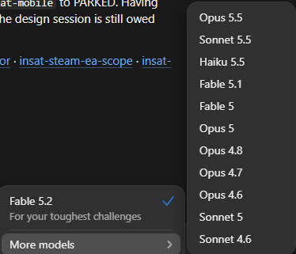
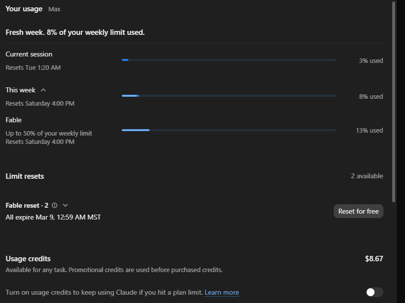
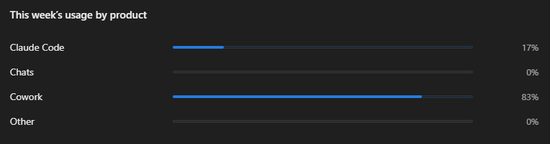

[Previous: Definitions, Part 3](/notes/definitions-part-3/)
{: .series-nav}

Now that the other terms are laid out, the last one is budget: how all of this turns into
spending, both money and tokens. I'll use a few screenshots along the way.

First, this changes often. In the early days, flat-rate plans gave heavy users far more
than they paid for, and the companies absorbed the difference to win customers.[^subsidy]
As billing shifted toward metered usage, it caught some customers off guard, spending
entire annual budgets in a short time.[^budget] Now they're working out specific prices
for different models and different customers, individuals versus enterprises. New models
come out all the time. You'd expect more capable models to cost more, and they do: Fable costs about
twice as much per token as Opus. But Fable 5.2 came out cheaper than the Fable before it,
because the companies also want to stay competitive, so it's a balancing act.[^pricing]
Anything I say here was true as of this writing, and much of it will change.

{: .inset}

In the screenshot image you can see the current models. The newest, Fable 5.2, came out
while I was writing this, and it's already in the app.

So how do the budgets work? Again I'm being specific to Claude, because that's the tool I
use, but the other major vendors run their services in broadly similar ways.

The word "session" gets slippery here, because it means two different things. One is a
single conversation, which has the context window from [Part 1](/notes/definitions-part-1/): one million tokens on most
current models. That sounds like a lot, and it's enough for my work, though mostly because
I've learned to work within it. When it fills, the conversation compacts and keeps going.
The other is the "Current session" on your usage page, which is a five-hour window that
counts every conversation that has been active during that time, be it one or many. That
one draws on your plan's usage, which is what you're paying for, and when it fills, you
stop.

This is where the rereading from [Part 1](/notes/definitions-part-1/) comes in. Before every reply, the model reads the
whole context window again. That doesn't take up any more room in the window, but it does
count against your usage. So the longer a conversation runs, the more each new message
uses, and starting a fresh session when you switch tasks resets that.[^1]

Claude's plans have two usage limits: one that resets every five hours, and a weekly
one. You pay by the month. There are four
plans, Free, Pro, Max and Ultra, and each step up costs more and gives you more models or
higher limits. I'm on Max, which you can see in the corner of the screenshot. I've
absolutely hit usage limits, and I'll give an example in a bit.

Over a week, the bars fill as I work: the current session, the
week, and a separate meter for Fable, because I can spend up to half of my weekly limit on
Fable. I've been using Fable heavily this week, so its bar reads higher than the weekly
one, 13 percent against 8.

There's also a breakdown of the week by product: Claude
Code, chat, Cowork. My design work is all in Cowork, with Fable, and I've done a lot of it
this past week, which is why Cowork's share is so high right now: 83 percent.

When you hit your weekly limit (mine resets on Saturdays), you either stop working until
it resets or pay as you go. You can see how in the screenshot: you buy usage credits, then
turn on the switch that says to keep going on credits if you hit a plan limit.

In my experience, and I won't claim it's everyone's, paying as you go is expensive. The
one time I tried it, partly just to see how it worked and what it cost, I was in the
middle of a Fable design session and hit my 5-hour limit. I turned on usage credits and
went through $50 of them in about 12 minutes. That wasn't an efficient use of the money,
or of the tokens. I turned that switch back off, and now I balance my usage over the week
so I don't hit the limits. When I do, I wait, a couple of hours or a day, until they
reset.

It takes a lot to burn through a big share of a week's usage in one go, but here's one
time I did. I was doing a release of the game. I have a series of tests that must run and
pass before any release, and I also wanted a regression pass and a multi-agent review of
the code. The session started six subagents, each with a different profile: one ran
regression tests, one ran unit tests, one checked the code against best practices, one did
security and vulnerability testing, and so on. Each ran its process and produced an output
file. Then six more agents each analyzed one testing agent's results. Those were rolled up
into a single report for me to review: a list of issues by severity. The must-fix bugs
were at the top. Then a set that weren't game-breaking or security problems, just
nice-to-haves. Then a dozen or so that were technical debt.

I don't get a meter for each of those agents, only the usage they add up to, and all
twelve drew on the same plan limits. I had about 30 percent of my weekly budget left when I
started that testing suite, and the twelve agents and the analysis after them used all of it in a
few hours. The run hadn't finished, so I waited a day and a half for the reset, kicked it
off again, and then got my results and a list of things to fix.

The complexity of the work, the number of agents you spawn, and the kinds of tasks they
run all count against your budgeted limits. It's worth keeping a balanced approach.

That's the vocabulary. To pull it together: everything you say, everything the agent says
back, and everything it thinks along the way is tokens. Those tokens fill the context
window, which holds one conversation. When the window gets close to full, compaction
squeezes it into a summary, and a handoff file carries forward what the summary would
lose. Memory holds what has to outlast any one conversation, kept in files and looked up
when it's needed. And all of it draws on your plan's usage limits, which are what you're
really budgeting. While we will certainly have to define more terms along the way, these
are some of the more essential ones that will come up again and again in the notes here.
I've collected them in a glossary for the site, and I'll add to it as new terms come up.
You'll find it linked at the bottom of every page.

[^subsidy]: The Register, quoting an AI consultancy's CEO: flat-rate plans "effectively subsidize usage." See source 3.
[^budget]: Fortune reported that Uber spent its entire 2026 budget for AI coding tools in four months. See source 4.
[^pricing]: Anthropic's API pricing page, as of November 2026: Fable costs twice what Opus does per token, and Fable 5.2 and Opus 5.5 each cost less than the version before. See source 5.
[^1]: Claude's pricing page: "How fast you reach a limit depends on the model you use, how long your chats are, and how large your files are." Anthropic's Claude Code docs say old conversation "costs tokens on every message." See sources 1 and 2.
